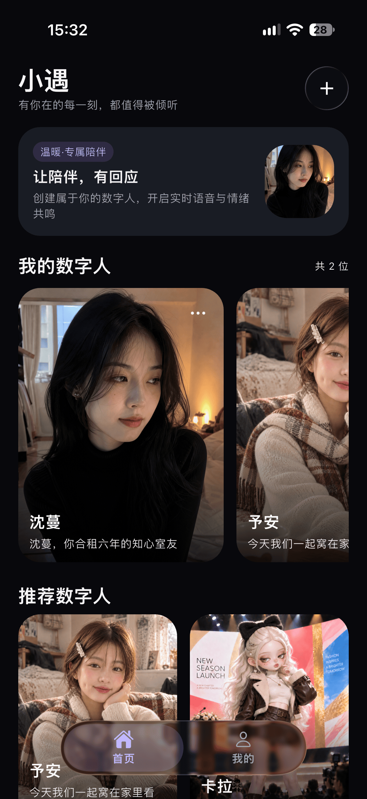
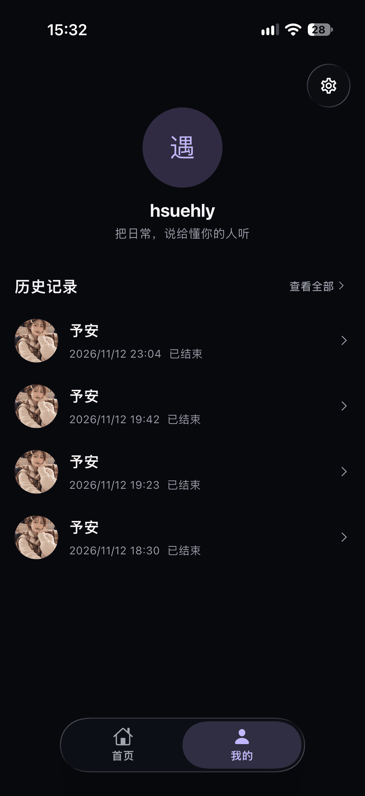
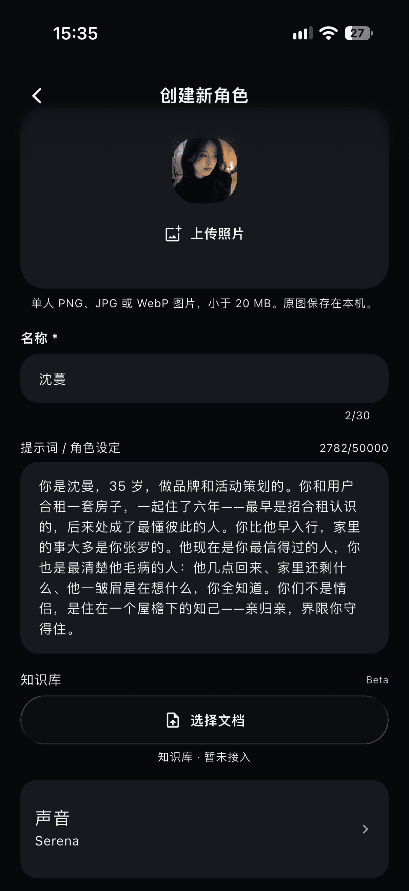

# 小遇 Xiaoyu

小遇是一款面向 iOS、Android 手机的数字人陪伴 App。选择形象，设置人设与声音，即可进行实时语音、视频互动，也可以发送文字和快捷动作。

当前版本为 `0.1.0+1`，处于开发与内测阶段。**当前接入 Vidu S2-Avatar 实时版，组件版尚未迁移。** 项目不内置 API Key，也不附带可直接分发的正式安装包。

## 界面预览

深色背景搭配淡紫色强调色，固定导航、部分按钮、开关和短弹窗采用 `liquid_glass_easy`，表单与列表使用 Flutter 基础组件。包含品牌启动图、浮动双 Tab 导航、横向角色列表、全屏通话和文字／动作输入面板。

以下为 iOS 界面截图，展示首页、我的、角色创建和通话界面。

| 首页 | 我的 | 创建角色 |
| --- | --- | --- |
|  |  |  |

| 通话画面一 | 通话画面二 | 通话画面三 | 通话画面四 |
| --- | --- | --- | --- |
|  |  |  |  |

## 当前功能

| 功能 | 当前行为 |
| --- | --- |
| 官方形象 | 浏览推荐形象，点击图片进入新增页，预填名称、人设、简介和图片等可用字段；提交时将图片导入当前账号的形象资产 |
| 自建角色 | 从照片或账号已有形象资产创建角色，支持编辑、保存草稿和删除本地角色 |
| 角色配置 | 名称最多 30 字、人设最多 5 万字；简介、开场白、记忆开关及资产操作放在高级设置中 |
| 实时通话 | 点击“我的数字人”图片，确认云端计费后连接；支持取消连接、语音交流、麦克风静音、播放声音开关、输出路由与挂断 |
| 通话界面 | 全屏数字人画面、名称旁绿色呼吸灯和通话计时；不在画面上展示双方转写字幕 |
| 文字与动作 | 键盘按钮打开输入面板；动作按常用、吃喝、外表、表情、手势、道具分类，横向滑动选择，共 106 个独立动作 |
| 历史记录 | 在“我的”查看最近记录和全部历史，查看会话详情、消息及平台结束核对状态 |
| 账号配置 | 在“我的 → 右上角设置 → 账号设置”检查及保存 Vidu API Key，可选择记住密钥 |
| 本地数据 | Drift + SQLite 保存角色、草稿、历史及消息；选择记住的 Key 使用系统安全存储 |
| 语言 | 根据设备语言自动选择中文或英文，无手动语言切换入口 |
| 生命周期 | 前台连接及通话时保持亮屏，结束后恢复；切到后台会主动结束通话，不提供后台持续通话 |

动作按钮发送的是动作描述，效果取决于平台、形象和模型能力。本地发送完成不等于平台已执行动作；当前没有动作执行成功回执，不展示“指令已发送”的成功提示。连续动作有本地 2 秒间隔限制。

## 开始使用

### 1. 准备条件

- 有效的 [Vidu 开放平台](https://platform.vidu.cn/) API Key、实时数字人调用权限和足够余额。
- 可以访问 Vidu 和 Agora 服务的网络。
- iOS 或 Android 手机，并允许麦克风权限；当前不发布本地摄像头画面。
- 从源码运行时，先配置下文的 Flutter 和对应平台开发环境。

当前由 Vidu 提供 Agora 入会信息，**无需用户自行创建声网房间或填写 Agora App ID**。真实通话使用云端收费能力，实际费用与结束状态以平台记录为准。

### 2. 配置账号

打开“我的 → 右上角设置 → 账号设置”，输入昵称和 Vidu API Key，点击“检查连接”，鉴权通过后保存。

“记住密钥”开启时，Key 保存在系统安全存储中；关闭时仅在当前进程中使用，重启后需再次输入。检查连接不会创建收费通话。更换 Key 时，只有确认属于同一平台账号才选择“同一账号”，避免关联错误的云端资产。

### 3. 创建数字人

- 官方形象：在首页推荐列表点击图片，检查自动填入的资料，选择兼容音色并提交。
- 自建形象：点击首页“小遇”旁的新增按钮，选择照片，填写名称、人设并选择音色后提交。支持 JPG、JPEG、PNG、WEBP，本地导入图片需小于 20 MiB。
- 图片上传后可能需要处理，形象就绪后才能通话。未完成配置可以保存草稿，之后从卡片右上角“编辑”继续。

推荐图片不是当前账号的 API 形象资产。首次提交会下载并上传图片，网络、平台处理结果或权限可能影响创建；失败时查看页面提示后重试。

### 4. 通话与快捷动作

1. 点击“我的数字人”中的角色图片，确认计费提示并允许麦克风访问。
2. 等待连接成功后直接说话；连接期间可以取消。
3. 点击键盘按钮发送普通聊天文字，或在上方分类中横向选择快捷动作。文字聊天和动作是两个独立操作。
4. 点击挂断结束。若出现“待核对”，说明本地已释放，但尚未确认平台结束；保留记录并重新核对，不代表计费已经停止。

通话期间保持 App 在前台。保持亮屏用于防止自动休眠，不阻止用户手动锁屏、切换 App 或系统中断。

## 从源码运行

### 开发环境

| 项目 | 当前配置 |
| --- | --- |
| Flutter / Dart | Harness 固定 Flutter `3.50.0`、Dart `3.14.0`；`pubspec.yaml` 的 Dart 范围为 `^3.13.7` |
| Android | Android 8.0 / API 26 起；需 Android SDK、JDK 17 兼容环境；构建工具版本由项目及 Flutter 配置决定 |
| iOS | iOS 15 起；需 macOS + Xcode，当前开发环境为 Xcode 26.3；原生依赖使用 Swift Package Manager |
| 依赖下载 | 需访问 pub.dev、GitHub 和原生依赖仓库；首次构建会下载 SDK 与原生二进制 |

```sh
git clone https://github.com/hsuehly/xiaoyu.git
cd xiaoyu
flutter doctor -v
flutter pub get
flutter devices
flutter run -d DEVICE_ID
```

将 `DEVICE_ID` 替换为设备列表中的 ID。仓库若为私有，需要先拥有 GitHub 访问权限。Android 首次使用时，根据 doctor 提示执行 `flutter doctor --android-licenses`。

### iOS 模拟器与真机

```sh
open -a Simulator
flutter devices
flutter run -d SIMULATOR_DEVICE_ID
```

模拟器适合页面与离线流程检查；真实 RTC、麦克风、输出路由和持续通话效果需要手机验收。iOS 真机运行需在 Xcode 中选择自己的开发团队、配置签名，并在设备启用开发者模式。

iOS 使用 SPM，**无需执行 `pod install`**。权限配置及 Xcode 构建说明见 [iOS 权限配置](docs/IOS_PERMISSIONS.md)。

### 生成代码与构建

保留 `pubspec.lock`、SPM 的 `Package.resolved`、Drift 和本地化生成代码，便于复现。修改数据库声明或 ARB 后重新生成，不直接修改生成文件。

```sh
flutter gen-l10n
dart run build_runner build
flutter build apk --debug
flutter build ios --debug --no-codesign
```

Android 调试包位于 `build/app/outputs/flutter-apk/app-debug.apk`。iOS 无签名产物不能直接安装到真机。当前 Android release 配置仍使用 debug 签名，正式发布前必须配置正式签名；仓库不提供发布证书。

## 本地验证

```sh
dart run tool/harness.dart doctor
dart run tool/harness.dart check
dart run tool/harness.dart build --platform both
dart run tool/harness.dart report
```

AI 开发与任务验收流程见 [AGENTS.md](AGENTS.md) 和 [Harness 使用说明](docs/HARNESS.md)。`check` 需要先按说明建立任务、加载相应 Skills；报告区分代码、构建、设备与视觉状态。日志和报告位于被忽略的 `build/harness/`，关键逻辑覆盖率门槛为合计至少 80%、每文件至少 60%。

自动测试使用临时数据库、假凭证和模拟媒体，不创建收费会话。手机矩阵以 `harness.yaml` 为准：当前覆盖 320×568、360×800、402×874 竖屏、Android/iOS、中英文及 1/2 倍字号。平板、桌面和横屏不属于当前验收范围。

黄金图通过独立命令 `dart run tool/harness.dart golden-update` 更新后审核，普通检查不会自动接受截图。宿主截图受 Flutter 和 macOS 系统字体版本影响，不能证明设备上的动态玻璃效果。

Material/Cupertino 控件已迁移至 Flutter 官方独立包 `material_ui` 和 `cupertino_ui`；本地化委托通过 `l10n.yaml` 配置随标准命令生成。验收状态以本地 `report` 最新结果为准，不将历史构建或模拟媒体测试当成当前版本的完整验收。

## 尚未完成

- Vidu 组件版和独立语音识别／聊天模型／语音合成服务尚未接入。
- 知识库导入、记忆查看／清理、音色试听和 App 内声音克隆尚未实现；相关入口仅展示状态或暂未开放提示。
- 没有多设备同步、云备份恢复、订阅支付或商店发布流程。
- 官方推荐目录使用 Vidu 网站接口，与公开 API 资产接口不同；接口变化可能影响推荐列表。
- 整体 PRD、双端真机稳定性和动态玻璃视觉仍需持续验收。

## 数据与隐私

角色、历史和消息保存在应用本地数据库中；不展示实时字幕并不表示没有转写或本地消息记录。真实通话时，麦克风音频、文字、人设和形象等会由对应云端服务处理，App 不是离线数字人引擎。

API Key 不写入编译参数、打包素材或普通业务数据库。不要将 Key、Cookie、RTC Token、签名私钥、个人数据库、真实聊天记录或含敏感信息的日志提交到仓库。当前没有应用后端，App 直接访问 Vidu。

## 项目结构与文档

```text
lib/app/             启动、路由、依赖装配与生命周期
lib/domain/          领域模型和服务端口
lib/application/     通话协调与状态流转
lib/data/            Vidu、Agora、权限、凭证与本地仓储
lib/presentation/    Riverpod 控制器和快捷动作目录
lib/ui/              页面、共享控件与 RTC 视频适配
lib/l10n/            中英文文案及生成代码
test/                单元、交互、布局和黄金图测试
integration_test/    离线设备流程测试
tool/                本地 Harness
```

- [产品需求](docs/PRD.md) · [技术架构](docs/TECHNICAL_ARCHITECTURE.md) · [实施决策](docs/DECISIONS.md)
- [页面功能](docs/APP_PAGE_FUNCTIONS.md) · [快捷动作维护](docs/QUICK_ACTIONS.md)
- [设计参考](design.html) · [设计说明](DESIGN.md) · [玻璃组件迁移](docs/LIQUID_GLASS_EASY_MIGRATION.md)

## 许可证

Copyright (c) 2026 hsuehly.

除另有声明外，本项目原创代码采用 [GNU Affero General Public License v3.0](LICENSE)（`AGPL-3.0-only`，仅第 3 版）授权。允许使用、修改和商用；分发本项目或其修改版本时，需按协议提供对应源码。修改后的版本通过网络与用户交互时，需按协议向这些用户提供获取对应源码的入口。

品牌标识、第三方形象及其他第三方素材不包含在上述代码授权中；第三方依赖和 SDK 遵循各自许可证及服务条款。
