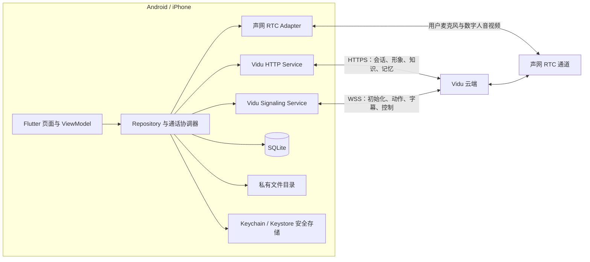
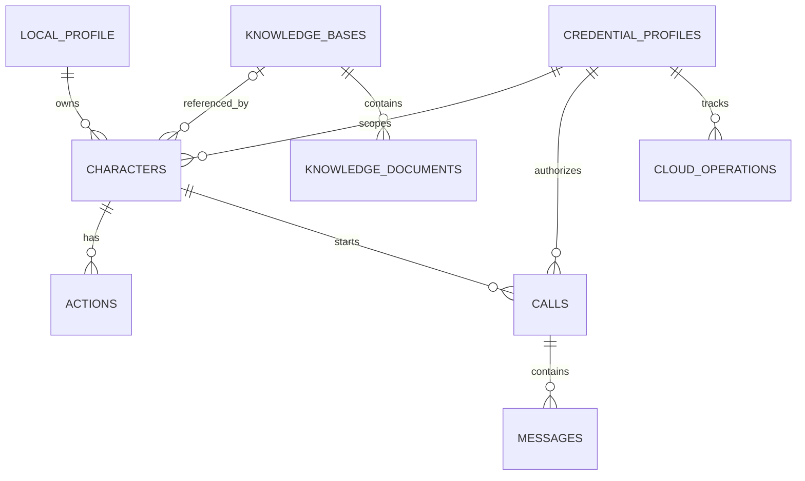
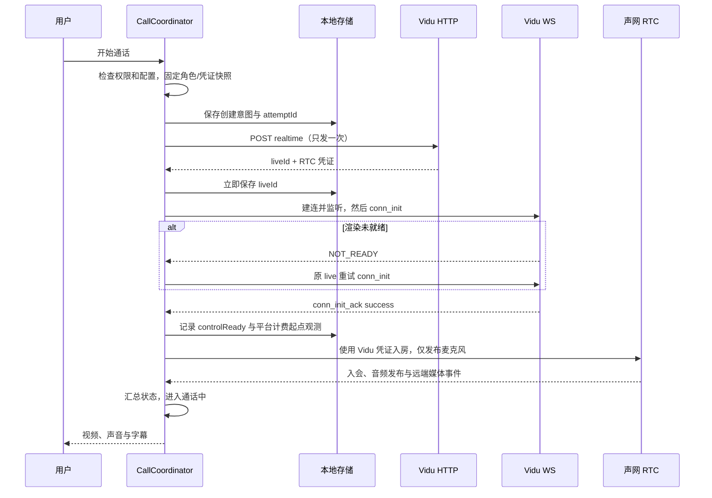
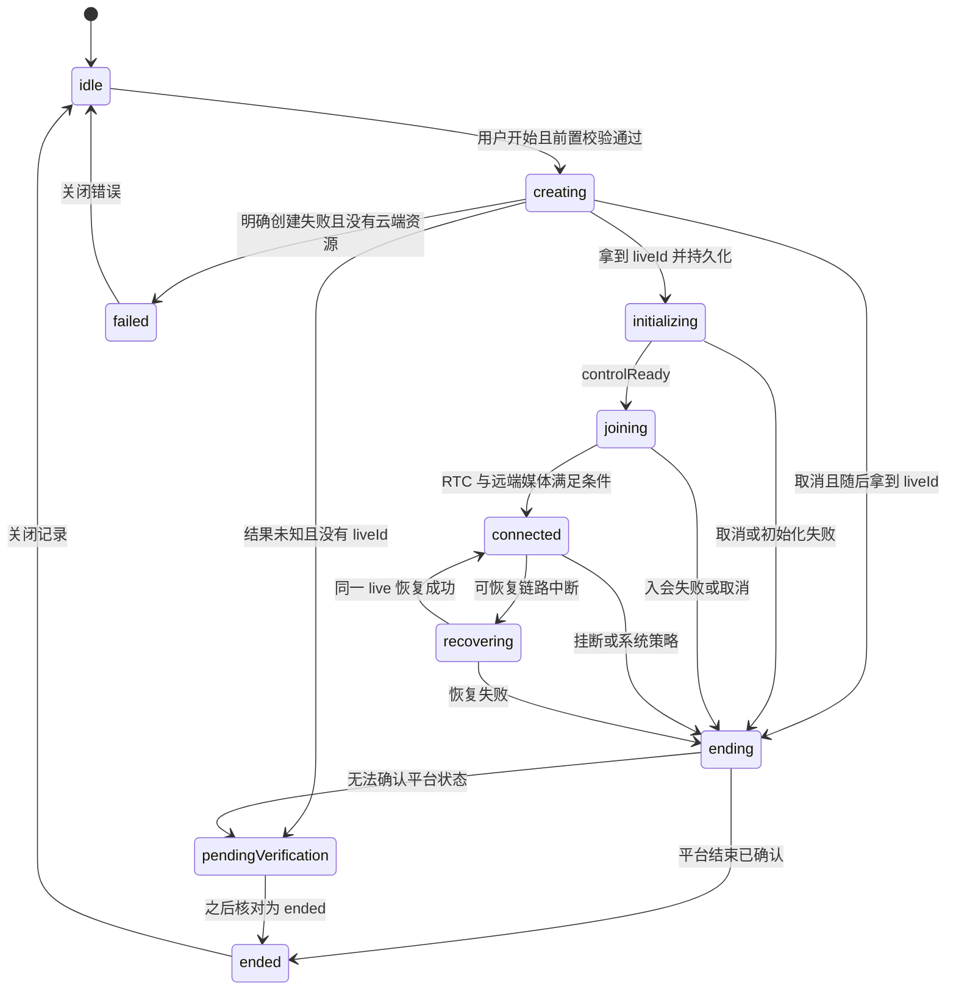

# 数字人陪伴 App 技术架构文档

| 项目 | 内容 |
| --- | --- |
| 版本与日期 | V1.2，2026-11-09 |
| 对应需求 | [PRD V1.2](./PRD.md)；[双 Tab 页面功能列表](./APP_PAGE_FUNCTIONS.md) |
| 平台与地区 | Flutter Android / iOS，中国大陆 |
| 界面语言 | 简体中文 `zh`、英文 `en`；默认跟随系统，可手动选择 |
| 架构基线 | 用户输入自己的 Vidu Key，App 直连 Vidu 实时版与 RTC |
| 文档状态 | 开发设计稿；尚未建立移动工程、创建收费会话或完成双端真机验证 |
| 适用范围 | PRD P0 功能；SDK、系统最低版本与性能目标在 M0 验证后冻结 |

## 1. 架构结论与决策

采用 Flutter 分层客户端架构。UI 使用 MVVM，由 Riverpod 提供依赖和状态，Repository 管理业务数据，Service 封装 Vidu HTTP、WebSocket、RTC 与系统能力。复杂的通话生命周期由应用级协调器负责，页面只订阅状态和发起命令。

| 决策 | 选择与原因 |
| --- | --- |
| ADR-01：运行方式 | App 直接连接 Vidu；首版不建设业务后端、账号中心或 GPU 服务 |
| ADR-02：数字人链路 | 使用 `/live/s_avatar/realtime`；不复用组件版的二进制 PCM 上行协议 |
| ADR-03：RTC | 显式选择 `agora`，集成 Agora Flutter SDK 6.6.4；iOS 使用 SPM，Vidu 提供入会凭证 |
| ADR-04：语音模型 | 默认 `qwen_omni`，满足国内文字与语音互动；RTC 和语音模型分别配置 |
| ADR-05：本地持久化 | Drift + SQLite 保存业务数据，私有文件目录保存图片，系统安全存储保存 Key |
| ADR-06：角色 | 完整角色配置本地保存，Vidu avatar 只是形象资产；每场 live 组合配置 |
| ADR-07：知识与记忆 | 使用 Vidu 托管知识库和长期记忆；原始聊天记录保存在本地 |
| ADR-08：资源所有权 | 一台设备仅一个活动通话；协调器独占其 HTTP 创建任务、WS、RTC 和计时器 |
| ADR-09：失败语义 | 本地连接释放、平台会话结束、账单最终结果分别记录，不互相推定 |
| ADR-10：前台范围 | 首版后台/锁屏结束通话；短暂失焦、权限弹窗与真正后台分别处理 |
| ADR-11：状态管理 | 确定采用 Riverpod，使用不可变状态、Notifier / AsyncNotifier 与流订阅；不再采用 Provider 包 + ChangeNotifier 方案 |
| ADR-12：本地化 | 官方 flutter_localizations + intl + ARB / gen-l10n；支持简体中文、英文与应用内语言选择 |

Vidu 默认通道就是阿里 ARTC。首版不同时集成多个 RTC SDK，因此声网不可用时提示通道问题，不自动切到未集成的 ARTC。

## 2. 系统与数据流



| 数据 | 传输与归属 |
| --- | --- |
| Vidu Key | 由用户输入；仅用于 Vidu 域名请求的鉴权 Header，不发给文件上传的第三方签名地址 |
| RTC App ID、房间、用户、Token | 从 Vidu 创建响应获取，直接交给对应 RTC SDK；无需用户输入声网 AppKey |
| 麦克风与数字人音视频 | 经 RTC 传输；App 不经控制 WS 上传音频，也不在 Dart 层逐帧搬运视频 |
| 人设与开场白 | 本地保存，创建 live 时发送到 Vidu |
| 图片 | 本地保留原图；创建云端资产时使用受支持的 URL 或图片 data URI |
| 知识文档 | 首版提交平台可访问的文档 URL，Vidu 索引；本地记录库和文档 ID |
| 长期记忆 | 保存在 Vidu 账号下，以稳定 profile / character 标识分区 |
| 聊天原文与用量 | 从转写和查询结果写入本地 SQLite；不默认录制整场音视频 |

## 3. 技术栈与依赖管理

| 范围 | 技术 | 使用约束 |
| --- | --- | --- |
| UI / 语言 | Flutter stable + Dart | 建立工程时锁定具体 Flutter 版本并记录 Dart、Xcode、JDK 版本 |
| 状态与依赖注入 | flutter_riverpod | Provider 注入服务；Notifier / AsyncNotifier 管理状态；StreamProvider 观察数据；构造器注入保留在业务对象中 |
| 路由 | go_router | 路由跳转不销毁应用级通话对象 |
| HTTP | Dio | 按操作定义超时与重试，避免全局 POST 重试 |
| 控制 WS | `dart:io` WebSocket | 移动端使用 Header 鉴权；不需要浏览器代理 |
| RTC | agora_rtc_engine | 固定 6.6.4；原生 SDK 4.6.4；iOS 经 SPM 接入 |
| 领域模型 | freezed / json_serializable | 生成不可变模型与 DTO，协议模型与领域模型分离 |
| 数据库 | Drift + SQLite | 事务、索引和 schema migration；DB 执行放到后台 isolate |
| 多语言 | flutter_localizations、intl、ARB、gen-l10n | `zh` 为简体中文资源，另有 `en`；生成源代码到项目内，跟随系统或手动选择 |
| Key | flutter_secure_storage | 保存或仅内存使用两种模式 |
| 本地文件 | path_provider、path | 使用 App 私有目录及可迁移的相对路径 |
| 权限与相册 | permission_handler、image_picker | 麦克风与相册按需申请，不因显示远端视频申请用户摄像头 |
| 播放预览 | video_player / just_audio，按实际需要引入 | 试听/预览播放与 RTC 独占音频焦点，进入通话前停止试听 |
| 标识与备份 | uuid；archive / file_selector / share_plus 按适配结果选择 | ID 长度遵守 Vidu 限制；备份不含凭证 |

Flutter、业务依赖和 RTC 的版本构成一个整体，不能只固定 Dart 包而任由底层原生库升级。提交应用 `pubspec.lock`，iOS 原生依赖锁文件也纳入版本管理；构建结果记录 Android/iOS 实际 RTC SDK 版本。

已核对 Agora Flutter SDK 6.6.4 发布包：Android 插件 minSdk 21，iOS Package.swift 声明最低 12.0；小遇以 Android 8 / API 26、iOS 15 为验证基线。Flutter 插件和 iris_method_channel 均有 SPM manifest，原生 AgoraRtcEngine_iOS 固定 4.6.4。

iOS 权限使用 pub 官方 `permission_handler`，由其自动引入 `permission_handler_apple`，无本地源码副本或依赖覆盖。SPM 从宿主 Info.plist 推导权限开关。双端业务代码统一调用 `Permission.microphone.request()`，Runner 不注册自定义权限通道。项目根目录的 Flutter 命令可自动发现配置；直接从 Xcode 构建的官方路径配置与缓存说明见 [iOS 权限配置](IOS_PERMISSIONS.md)。

### 3.1 Riverpod 与数据库选型

Riverpod 用于组合异步依赖、按角色隔离查询、统一 loading / error / data 与替换测试依赖。首版直接使用 `flutter_riverpod`，代码生成按需要增加 `riverpod_annotation` / `riverpod_generator`，不要求引入实验性的离线持久化或 Mutation API。

| 对象 | Riverpod 组织方式 | 生命周期与约束 |
| --- | --- | --- |
| DB、Repository、HTTP Service | Provider | 应用级创建；对象通过构造器注入依赖，退出时集中释放 |
| CallCoordinator | 应用级、不自动释放的 Provider | 初始化只创建协调器，不创建收费 live；不依赖 locale、当前路由或页面监听人数 |
| 数字人列表、历史、当前通话状态 | StreamProvider | 观察 Repository / Coordinator；页面暂停订阅不停止底层通话与必要数据归档 |
| 编辑表单与提交状态 | Notifier / AsyncNotifier | 角色 ID 对应的 family；返回离开前处理未保存内容；locale 变化不重建草稿 |
| 知识库、音色、角色记忆读取 | FutureProvider / AsyncNotifier + family | 只读加载可有界重试；参数包含角色和凭证范围 |
| 语言偏好 | Notifier + SettingsRepository | 应用级不可变状态，持久化偏好；仅更新 App locale，不重建 router 或通话依赖 |

Provider 是 Riverpod 内的依赖提供器名称，不代表同时引入 `provider` 包。根节点使用 ProviderScope；视图通过 ref.watch 读取状态，通过明确命令执行写操作，业务层不依赖 WidgetRef。

Riverpod 3 的初始化失败自动重试不能用来重试 live 创建。收费创建、知识导入和删除等写操作仅从显式命令执行，按接口规则处理结果未知；不能放进因 watch 变化而重新运行的 build。keepAlive 不阻止依赖变化导致重新计算，因此 CallCoordinator 不 watch 会变化的 Key 或语言；开始命令固定角色与凭证快照。

保留 Drift + SQLite：本产品有角色 → 通话 → 消息关联、凭证范围、唯一 ID、待核对状态、分页与用量统计，适合关系表和索引；Drift 提供类型安全查询、响应式监听及可测试迁移。Isar Community 的对象、索引、Watcher 与事务也能实现这些功能，但本项目更重视关系约束、SQL 查询与历史数据升级，不基于未经测量的性能差异作选择。

### 3.2 中英文资源与语言切换

Flutter 工程建立后添加 SDK 依赖 `flutter_localizations` 与兼容 Flutter 约束的 `intl`，在 `pubspec.yaml` 设置 `flutter.generate: true`。维护 `lib/l10n/app_en.arb`、`lib/l10n/app_zh.arb`，其中 zh 内容为简体中文。建议 `l10n.yaml`：

```yaml
arb-dir: lib/l10n
template-arb-file: app_en.arb
output-dir: lib/l10n/generated
output-localization-file: app_localizations.dart
nullable-getter: false
```

使用 `flutter gen-l10n` 生成资源，从本工程 `lib/l10n/generated/app_localizations.dart` 导入；不使用旧 synthetic-package 或 flutter_gen 导入方式。根 App.router 配置 AppLocalizations.localizationsDelegates、supportedLocales 与已解析 locale，保持 routerConfig 对象稳定。

语言偏好值保存为 `system`、`zh`、`en`，由 SettingsRepository 写入现有 settings 表，ProviderScope 启动前尽量完成读取，避免首屏语言闪变；不再复制一份状态到 shared_preferences。首次使用 system，按系统语言列表顺序匹配首个 zh / en，中文地区或脚本变体统一映射简体 zh，英文变体映射 en；全部不支持时回退 en。手动选择立即生效、重启保留；仅 system 模式响应系统语言变化。

所有界面文案、错误提示、空态、确认弹窗、无障碍标签和内置模板说明进入 ARB；日期、数量、占位符和英文复数由 intl / ICU 格式化，不拼接翻译片段。领域层和历史状态保存错误分类、状态码与参数，不持久化当时语言的提示文本。预置动作保存稳定 ID，显示名称本地化，已保存的用户动作描述保持原文。

用户名称、提示词、角色简介、文档、对话、云端记忆保留原文。界面语言不修改 persona、音色、RTC provider 或 Vidu 国内域名，也不自动触发 live 初始化。英文对话、转写与动作效果按 voice model / voice 组合单独验收，不能用英文界面代替能力验证。

Android / iOS 应用名称与系统权限用途说明需要原生双语资源，Flutter ARB 不会自动翻译权限弹窗；iOS 配置相应 InfoPlist.strings 与支持的本地化，Android 配置适用的 strings.xml。系统弹窗语言遵循平台语言机制，应用内选择不保证修改 OS 弹窗语言。字体按中英文回退，布局允许英文更长与系统字体放大；玻璃控件也需双语可读性与语义标签验收。

## 4. 建议工程结构

小遇已在仓库根目录建立 Flutter 工程，直接使用现有 `lib/`、`android/`、`ios/`，不再新增 `mobile/`。cyber-xiaoya-live 只作交互与效果参考，不复制其代码或素材。

```text
./
  lib/
    app/
      bootstrap.dart
      dependency_graph.dart
      router.dart
      lifecycle_coordinator.dart
      locale_controller.dart
    l10n/
      app_en.arb
      app_zh.arb
      generated/
    core/
      result.dart
      app_error.dart
      clocks.dart
      diagnostics.dart
    domain/
      models/
      ports/
      use_cases/
        start_call.dart
        clear_character_memory.dart
        restore_profile.dart
    data/
      dto/vidu/
      local/
        database/
        daos/
        credential_store.dart
        asset_store.dart
      services/
        vidu_api_service.dart
        vidu_signaling_service.dart
        rtc/agora_rtc_adapter.dart
      repositories/
    application/
      call_coordinator.dart
      call_reducer.dart
      action_scheduler.dart
      transcript_assembler.dart
      reconciliation_service.dart
    ui/
      core/
      integrations/rtc_video_surface.dart
      features/
        onboarding/
        characters/
        character_editor/
        call/
        actions/
        knowledge/
        memory/
        history/
        settings/
  assets/catalogs/
  test/
  integration_test/
  android/
  ios/
```

UI feature 内再分 `views/` 与 `view_models/`；ViewModel 由 Riverpod Notifier / AsyncNotifier 实现，或由流 Provider 组合领域状态。底部导航仅“首页 / 我的”，feature 目录是代码组织，不等同于 Tab；首页聚合角色模块，我的聚合历史、账号和设置，通话采用全屏路由。Domain 不依赖 Dio、Drift、声网插件或 Flutter Widget；RTC 视频视图在 UI integration 层封装，避免供应商类型传遍页面。

## 5. 模块职责与对象生命周期

| 模块 | 职责 | 生命周期 |
| --- | --- | --- |
| CharacterRepository | 草稿、完整角色、原图和云资产引用 | 应用级 |
| CredentialRepository | 当前凭证配置、内存凭证、安全存储读写 | 应用级 |
| VoiceRepository | 内置目录、自定义音色缓存、兼容性校验 | 应用级；缓存按凭证配置隔离 |
| KnowledgeRepository | 知识库和文档目录、引用、处理状态 | 应用级 |
| MemoryRepository | 按 profile/character 查看和清空云端记忆 | 应用级；切配置清理缓存 |
| HistoryRepository | 通话记录、字幕与用量持久化 | 应用级 |
| SettingsRepository / LocaleController | 语言与普通偏好持久化；计算有效 locale | 应用级，不参与收费会话创建依赖 |
| CallCoordinator | 串行处理命令与事件，拥有当前 CallAttempt | 应用级唯一实例 |
| ViduApiService | 编码请求、鉴权、解析响应和协议错误 | 每凭证版本的请求上下文；不依赖可变全局 Key |
| ViduSignalingService | WS 连接、序列号、编解码、协议事件流 | 每个 live / 连接实例 |
| AgoraRtcSession | SDK 引擎、频道、设备、媒体与回调 | 每个通话尝试；首版结束后完整释放 |
| ReconciliationService | 核对本机已知 live、补查用量 | 应用级，有界执行 |
| ViewModel | 将领域状态转换为页面状态，执行界面命令 | 页面级 |

Service 层不承担角色选择和通话重试决策。HTTP Service 接近无状态；WS 和 RTC 因协议需要持有连接状态，但业务生命周期只由协调器决定。

CallViewModel 销毁只解除页面订阅，不调用引擎销毁。音频结束、用户挂断和应用退出统一进入协调器的结束流程，防止页面重建导致重复入会。

仅为跨模块复杂流程建立 Use Case；普通角色 CRUD 直接走 Repository。通话协调器不依赖 UI，Repository 接口和事件模型允许用 fake 实现验证状态变化。

## 6. 模块接口与领域状态

下列是设计契约，名称为 App 自有抽象，不是供应商 SDK 方法；实现时用不可变模型与 Result 类型补齐定义。

```dart
abstract interface class CallGateway {
  Stream<CallSnapshot> watchCall();
  Future<Result<void>> start(StartCallCommand command);
  Future<Result<void>> end(EndCallReason reason);
  Future<Result<void>> sendText(String text);
  Future<Result<void>> sendAction(String description);
  Future<Result<void>> interrupt();
  Future<Result<void>> setMicrophoneMuted(bool muted);
  Future<Result<void>> selectAudioRoute(AudioRouteId route);
  Future<Result<void>> requestVoiceChange(VoiceId voice);
}

abstract interface class RtcSessionPort {
  Stream<RtcEvent> get events;
  Future<Result<void>> join(RtcJoinInfo info);
  Future<Result<void>> setMicrophoneMuted(bool muted);
  Future<Result<void>> selectAudioRoute(AudioRouteId route);
  Future<Result<void>> leaveAndDispose();
}

abstract interface class SignalingSessionPort {
  Stream<SignalEvent> get events;
  Future<Result<void>> connect();
  Future<Result<void>> initialize();
  Future<Result<void>> send(SignalCommand command);
  Future<Result<void>> close();
}
```

`join()` 返回成功仅表示 SDK 已接受入会请求；实际入会成功由 `RtcEvent.joined` 确认，后续失败同样通过事件上报。协调器监听事件并设置入会超时，不将 Future 成功视为已接通。`send()` 成功表示本地写出，不代表动作、打断或文字被平台执行业务确认。

| 领域对象 | 关键内容 |
| --- | --- |
| CallAttempt | attemptId、callId、不可变角色快照、凭证版本、cancelRequested、生成代号 generation |
| CallSnapshot | phase、controlReady、rtcJoined、audioPublished、remoteAudioReady、videoFirstFrame、micMuted、route |
| CallRecord | liveId、创建/就绪/本地释放/平台结束时间、结束原因、平台状态确认、账单状态 |
| CharacterSnapshot | 稳定 characterId、persona、avatarId、voice provider/voice、knowledgeBaseId、memoryEnabled、revision |
| CredentialSnapshot | credentialProfileId、version、环境 host；Key 仅在运行期请求上下文中持有 |
| RtcJoinInfo | provider、appId、roomId、userId、token、expiresAt，内存对象 |

不要把 UI phase 变成账单真相。`localReleased`、`remoteEndConfirmation`（unknown/confirmed/unverifiable）与 `billingStatus`（pending/observed/settled）分开保存。平台结束后账单仍可能延后返回；没有核实终态规则前，`settled` 不能仅由本地挂断触发。

## 7. 本地数据模型



| 表 | 关键字段 | 约束 / 索引 |
| --- | --- | --- |
| local_profiles | profile_id、display_name、explicit_facts_json、created_at | profile_id 持久化，长度 ≤ 64 |
| credential_profiles | id、label、environment、credential_version、storage_mode、secret_ref | DB 不存 Key；凭证版本递增 |
| characters | id、profile_id、credential_profile_id、name、persona_raw、persona_compiled、persona_template_version、greeting、action_prompt、image_path、avatar_id、asset_status、asset_created_at、voice_provider、voice、knowledge_base_id、memory_enabled、revision | ID 长度 ≤ 64；profile/配置外键；按最近使用索引 |
| actions | id、character_id 可空、name、description、sort_order、source | character_id + sort_order 索引 |
| knowledge_bases | credential_profile_id、remote_id、name、status、last_synced_at | 配置 + remote_id 联合唯一 |
| knowledge_documents | credential_profile_id、base_id、remote_id、name、source_url、status、error_code | 配置 + base_id + remote_id 联合唯一 |
| calls | id、attempt_id、profile_id、character_id、credential_profile_id、credential_version、character_snapshot_json、live_id 可空、phase、end_confirmation、billing_status、end_reason、trace_id、关键时间、billed_seconds、credits_cost | 配置 + 非空 live_id 唯一；end_confirmation 索引 |
| messages | id、call_id、speaker、local_request_id、remote_message_id、connection_epoch、last_seq、text、finality、delivery_state、created_at | call_id + created_at 索引；有稳定远端 ID 时按会话/说话者去重 |
| cloud_operations | id、配置/凭证版本、kind、resource_id、request_id、status、last_error、created_at | 记录创建不确定、待确认结束、待核对删除；不保存凭证与整段请求敏感正文 |
| settings | key、value_json、schema_version | 仅普通偏好；不存 Key |

知识库外键使用“配置 + 库 ID”的组合，防止不同配置相同字符串 ID 相互引用。角色删除可保留历史快照或作软删除，不能级联抹掉仍待核对的 calls。头像引用计数归零后才允许清理源文件。

`calls.live_id` 为空可表示创建意图已写入、响应尚未拿到；它不是“服务端一定没创建”。首版通过应用级互斥防止本机并发创建，数据库再以活动尝试事务检查兜底，不以页面按钮是否置灰作为唯一保护。

所有平台 ID 使用字符串，时间戳显式处理秒/毫秒，数据库统一保存 UTC。时长统计使用单调时钟，界面展示按设备时区转换。积分保留平台原始精度，用十进制定点/Decimal 计算展示，不用二进制 double 做最终对账。

### 7.1 数据库与文件事务

SQLite 事务不跨网络持有。云端成功与本地落库之间采用操作记录衔接：先写意图，收到资源 ID 后马上写入，之后更新角色引用；中途失败保留可核对状态。

图片先写临时文件、校验并原子移动到私有目录，再提交数据库引用；启动清理超过保留时间且无引用的临时文件。迁移使用 Drift schema version，测试旧版本到新版本升级，不通过删库修复升级错误。

### 7.2 数据目录

```text
app_support/
  database/companion.sqlite
  profiles/<profile_id>/characters/<character_id>/original.jpg
  catalogs/voice_catalog.json
  diagnostics/<date>.jsonl
cache/
  previews/
  voice_samples/
  upload_temp/
```

数据库保存相对路径；安装或恢复位置变化后由 AssetStore 解析实际绝对路径。原图属于长期业务文件，不能放进可被系统随时清理的 cache。

## 8. 凭证、身份和账号归属

| 标识 | 含义 | 变化规则 |
| --- | --- | --- |
| profile_id | 本地用户记忆身份，传 memory user_id | 首次生成或从备份恢复，通话间不变 |
| character_id | 本地完整角色，传 memory agent_id | 换图、换音色、重建 avatar 均不变；复制角色生成新 ID |
| credential_profile_id | App 内一套逻辑云端配置 | 不等同于 Vidu account ID；不同账号使用不同配置 |
| credential_version | 该配置的 Key 修订版本 | 修改 Key 后递增；运行中请求仍绑定原快照 |
| call_id / attempt_id | 本地通话记录及一次创建尝试 | 每次用户明确开始生成 |
| live_id | Vidu 云端实时会话 | 仅由创建响应确定，不能按时间猜测 |

Key 保存由 CredentialStore 封装。选“仅本次使用”时只驻留内存，重启不会为恢复任务偷偷持久化；存在待核对 live 时请求用户重新输入对应 Key 再继续。安全存储中 Key 的可用性不能与 SQLite 记录默认等同，清除、系统恢复或安全存储不可用需要独立状态。

修改 Key 时先处理当前活动通话。对于用户明确说明是同账号换 Key 的情况，可保留原逻辑配置与身份；先用新 Key 检查代表性资源的访问权限。没有统一账号身份接口证据时，不能仅凭 Key 字符串或一次列表成功推定它们属于同账号。失败时保留原资源引用，避免自动“迁移”到其他账号。

清除凭证和删除云端资源是不同命令。若用户选择清除存在未结束记录的凭证，说明待核对记录会保留但后续需要重新输入 Key，不阻止其清除，也不将记录改成已结束。

鉴权 Header 为 `Authorization: Token <用户Key>`。专用 Vidu HTTP/WS 客户端才附加 Header；文件 PUT、文档 URL 预检与第三方媒体请求使用独立无鉴权客户端。禁止通用 Dio logger 输出请求 Header、RTC Token、整张 base64 图片和完整用户对话。

## 9. 角色、人设与形象资产

官方形象通过用户提供的 Vidu 官网 `/live/v1/keeper/avatar/roles?avatar_types=system` 匿名读取，独立封装、不携带 Key 或 Cookie。选用后生成新的本地 character ID；图片创建为当前账号的公开 API avatar 资产，网站 role ID 与 avatar ID 分开保存。

完整角色写入 CharacterRepository。按照 PRD，persona 以用户填写的完整多行提示词为主，不要求重复填写结构化性格、身份和背景。PersonaCompiler 仅组合有明确边界的角色名、用户提示词原文及用户主动设置的应用上下文；分别保存原文、编译结果与模板版本，可预览实际发送内容，不静默扩写、截断或覆盖原文。

| 步骤 | 实现 |
| --- | --- |
| 新建草稿 | 生成稳定 character_id，立即保存本地；缺图/音色时也允许保存草稿 |
| 选择图片 | 使用相册选择器，读取后复制到私有目录；处理方向、大小与格式 |
| 创建形象 | `POST /live/v1/avatars`，传 image_uri 和可选 name；data URI 必须有正确 MIME 前缀 |
| 查询处理 | 有界查询 `GET /live/v1/avatars/{id}`，区分 created / processing / success / failed |
| 保存引用 | 云端 ID 与凭证配置关联；角色原图和业务 ID 不依赖云端 ID |
| 开始通话 | avatar.id 与 avatar.image_uri 二选一；优先已就绪的资产 ID |
| 失效重建 | 查询确定失效后由用户触发重建；更新 avatar_id，保持 character_id |

当前文档：公网图片 ≤ 50MB，base64 解码后 < 20MB，支持 PNG/JPG/JPEG/WEBP，单人图片。App 设置更保守的压缩目标以减少网络和内存开销，但产品限制要与平台限制区分。编码大图放到 isolate，不在每次 Widget build 重复编码。

图片资产官方保留期为 90 天。`asset_created_at` 用于提醒，实际可用性以查询结果为准；不能只按本地时间推定已经删除，也不在每天启动时批量重复创建云资产。

### 9.1 会话参数构造

SessionRequestBuilder 只接受不可变的 CharacterSnapshot、ProfileSnapshot 和产品设置，输出经过校验的 DTO。禁用未绑定功能时省略配置，禁止发送占位资源 ID。

```json
{
  "model": "vidu-s2",
  "call_mode": "video",
  "resolution": "720p",
  "rtc": { "provider": "agora" },
  "voice_model": { "provider": "qwen_omni" },
  "avatar": {
    "id": "VIDU_AVATAR_ID",
    "persona": "你叫林汐，性格温柔自然。认真倾听，用简短口语回应，保持一致的人物设定。",
    "voice": "Serena",
    "greeting_instruction": "自然打招呼，询问今天过得怎么样。"
  },
  "audio": { "enable_transcription": true },
  "action": { "enabled": true, "library_id": "0" },
  "knowledge_retrieval": {
    "enabled": true,
    "provider": "vidu",
    "knowledge_base_id": "VIDU_KNOWLEDGE_BASE_ID"
  },
  "memory_retrieval": {
    "enabled": true,
    "provider": "vidu",
    "user_id": "STABLE_PROFILE_ID",
    "agent_id": "STABLE_CHARACTER_ID",
    "enable_write": true
  },
  "idle_timeout_seconds": 300,
  "enable_recording": false
}
```

上例只说明字段组合，资源 ID 需要替换为当前配置下的实际资产。动作风格、VAD、静默动作等按已验证参数补充；persona 和开场提示在构造前执行平台长度校验。

## 10. Vidu HTTP 接入与错误模型

国内固定 `https://api.vidu.cn`。DTO 只在 Service 边界使用，通过 Mapper 转领域对象。缺失可选字段容忍，缺少 live ID、RTC provider 或必要凭证则返回协议错误，并进入资源核对，不把响应原文直接输出到 UI。

| API | 用途 | 重试策略 |
| --- | --- | --- |
| `GET /live/v1/avatars?pager.page=0&pager.pagesz=1` | 非收费 live 的只读鉴权检查 | 网络/5xx 有界重试；空列表也可通过鉴权 |
| `POST /live/s_avatar/realtime` | 创建 live | 不自动重试；超时属于结果不确定 |
| `GET /live/v1/lives/{id}` | 状态和账单 | 有界退避查询，不据一次失败认定结束 |
| `/live/v1/avatars` 及 `/{id}` | 图片资产管理 | GET 可重试；POST 先记录意图，响应丢失先核对 |
| `GET /live/v1/voices` | 当前账号自定义音色 | 配置范围缓存；不是所有预置音色的列表接口 |
| `/live/v1/knowledge-bases` 和 documents | 知识库和资料 | 创建/导入不盲重试；长处理使用专属超时 |
| `/live/v1/memories/list`、`/search` | 查询记忆 | 虽是 POST，其语义只读，可显式配置有界重试 |
| `DELETE /live/v1/memories` | 清空指定用户/角色范围 | 先冻结该角色写入，超时进入删除待核对 |

普通读取初始建议连接超时 10 秒、接收超时 20 秒；live 创建接收超时与 PRD 45 秒准备预算协调，形象/知识文档等长任务单独设置，不共享一套短超时。预算数值属于产品初值，M0 后校准。

Vidu 文档部分创建 API 使用 `X-Request-ID`。客户端可保存它用于关联，但官方没有明确保证幂等时，不能把重发同 request ID 当作绝不会创建重复资源。

错误模型至少包含 category、可读 messageKey、httpStatus、platformCode、traceId、retryDisposition 与 resourceOutcome。后者区分“请求明确失败”和“服务端可能已经成功”；401、403、503、NOT_READY、平台强制结束分别映射，不用一个“网络异常”覆盖全部情况。

## 11. WebSocket 协议适配

使用 `wss://api.vidu.cn/live/ws/live/connect?live_id=...&conn_id=...`，Header 鉴权。建立连接后先安装唯一接收循环和事件订阅，再发送 conn_init，避免快速回执在监听前丢失。

```json
{
  "type": 101,
  "live_id": "CURRENT_LIVE_ID",
  "conn_id": "CURRENT_CONNECTION_ID",
  "seq_id": 14,
  "payload": {
    "text_action": {
      "msg_id": "LOCAL_REQUEST_ID",
      "content": "看向镜头，微笑挥手"
    }
  }
}
```

| type | 方向 | 适配后事件/命令 |
| --- | --- | --- |
| 1 / 2 | 上行 / 下行 | initialize / initializationResult；NOT_READY 在原 live 上退避重试 |
| 5 / 6 | 上行 / 下行 | requestHangup / forceHangup，保存原因 |
| 7 | 上行 | interruptOutput，不要求独立成功回执 |
| 9 / 10 | 下行 | 用户/角色转写；实时版中不能当成组件版上行文本协议 |
| 97 / 98 | 上行 / 下行 | updateSession / sessionUpdateResult |
| 99 / 102 | 上行 | 通用文字 / 只聊天，默认入口采用只聊天 |
| 101 | 上行 | 动作文本，无独立成功回执 |
| 103 | 下行 | 平台错误，按 source、msg_id、可用 seq_id 关联 |

连接实例管理上行递增序列号；本地另有 connectionEpoch 区分重连前后的序列。平台下行序列不与本地上行强行合并。解析异常或未知 type 记录脱敏诊断，不使唯一接收循环崩溃。

### 11.1 心跳与重连

官方要求 15 秒内有消息维持活性，但未明确列出业务 heartbeat type。首版设计为 HeartbeatPolicy 适配点：M0 验证协议 Ping/Pong 是否满足 Vidu 的存活判断，再选择受支持方式；不能通过空动作、重复文字或反复 conn_init 假装心跳。

底层短时网络恢复优先依赖 SDK 能力。控制 WS 重连到同一 live 是否允许、conn_id 如何变化、能否重新初始化均需验证；未验证的能力默认关闭。发生错误先禁用新业务命令，再由协调器决定有界恢复或结束核对，不自动创建新 live。

### 11.2 音色更新确认

session_update 文档示例的回执未保证有唯一请求关联字段，首版同一连接最多一个在途配置更新。若回执超时，状态为 `unknown`，暂停后续更新；不能直接发第二条后将迟到回执误认为第二条成功。

区分 preferredVoice（下场通话偏好）、requestedVoice（本次请求）、acceptedVoice（平台确认接受）和 audibleVoiceStatus（是否确认已听到新音色）。ack success 只表示配置被接受，当前播报结束后才生效，不能立即宣称已播放新声音。失败或未知状态不修改已确认的会话配置；新会话从明确的本地偏好重新构造。

## 12. 声网 RTC 适配与媒体渲染

### 12.1 字段映射

| Vidu 字段 | App 领域字段 | Agora SDK 用途 |
| --- | --- | --- |
| rtc.provider | provider | 必须为已集成的 agora，否则终止准备并清理 live |
| rtc.app_id | appId | RtcEngineContext.appId |
| rtc.channel_id | roomId | joinChannelWithUserAccount.channelId |
| rtc.user_id | userAccount | 原样传入 joinChannelWithUserAccount.userAccount，不转换成数字 UID |
| rtc.token | token | joinChannelWithUserAccount.token |
| rtc.token_expire_at | expiresAt | 没有已核实续签接口；到期时结束，由用户重新开始 |

Vidu 签发的用户标识是字符串，即便只包含数字也不转换。远端渲染回调中的数值 UID 由 Agora SDK 提供，不能从自己的 userAccount 推算。

### 12.2 SDK 接入顺序

1. 创建 RtcEngine，使用 Vidu 返回的 App ID 初始化并注册 RtcEngineEventHandler。
2. enableVideo 后显式 enableLocalVideo(false)，入会前关闭本地采集；不调用 startPreview。
3. 使用 ChannelMediaOptions(publishMicrophoneTrack: true, publishCameraTrack: false, autoSubscribeAudio: true, autoSubscribeVideo: true)。
4. 使用 joinChannelWithUserAccount(token、channelId、userAccount) 入会。
5. 分别等待入会、上行音频发布、对应远端音频订阅、远端渲染首帧的真实回调，再进入已连接状态。
6. 结束时静音、停止采集、leaveChannel，等待离会回调，注销处理器并 await release(sync: true)；原生释放完成前不创建新引擎。

### 12.3 远端用户与画面

RTC 用户上线、流发布、订阅状态和首帧由适配器转换为领域事件。不能根据自己的 rtc.user_id 推算数字人远端 ID，也不能随意把所有回调绑定到同一视图。M0 核实 Vidu 远端用户/流身份，建立与当前 room 关联的选择规则；出现不符合预期的多个远端流时保留诊断，不随机显示。

UI 的 RtcVideoSurface 消费内部 RemoteVideoHandle，封装候选 SDK 的 AgoraVideoView / VideoViewController.remote 等供应商视图。页面可以挂载或卸载渲染视图，但不能直接 leaveChannel。底层视频保持 SDK 原生渲染，不转成 Dart Uint8List 再逐帧刷新 Widget。

静音优先使用 SDK 的音频发布/采集控制实现，对外契约是“不上传用户声音”。具体是否停止采集由版本支持和恢复稳定性决定，使用实际回调更新状态。仅改变按钮图标或关闭远端播放不算麦克风静音。

### 12.4 音频设备

由 RTC 适配器管理扬声器/听筒与可用路由，监听路由变化。蓝牙选择结合 SDK 与系统提供的能力，不承诺能枚举或强制切换所有设备。

iOS 音频会话与 Android 音频焦点以 RTC SDK 管理为主；避免其他音频插件在通话中抢占。开始通话前停止预览音频；结束后恢复播放器状态与系统音频。系统来电、音频中断和路由失败统一进入协调器，不在页面分别执行一套清理。

## 13. 通话建立时序与状态机

### 13.1 正常建立



基线采用官方视频 Demo 的“先 init 成功，再 RTC 入会”顺序，避免把未经验证的并行初始化当成前提。M0 可验证安全并行入会以缩短等待，但事件聚合仍分别判断就绪。init 成功到手机首帧之间可能已经计费，单独记录这段准备时间。

进入通话中需要 controlReady、RTC 入会成功、用户音频发布成功、目标远端音频订阅可用及视频首帧就绪。远端音频就绪以流和订阅状态判断，不要求数字人持续说话或收到非静音音频帧，避免静默时误判未接通。

### 13.2 状态转换



pendingVerification 可留在历史记录中，不要求 UI 一直显示全屏等待。若已释放本地媒体但前一场 live 尚未确认结束，新建前明确提示旧状态不确定；不自动重复创建。没有 live ID 时无法可靠核对具体会话，是直连创建请求的剩余限制。

### 13.3 事件并发与不变量

协调器用串行事件处理或 reducer 管理状态，所有回调携带 attemptId / generation。不变量如下：

- 每台设备同一时间最多一个创建请求和一个活动 RTC 房间。
- start 重复调用返回同一在途任务；end 重复调用共享同一结束任务。
- 用户取消立即写 cancelRequested 并停止新输入，但已发出的创建请求仍由后台结果处理器接管。
- 旧 generation 的事件不修改新通话 UI；若事件带回旧 liveId，仍必须持久化并结束/核对该资源，不能直接丢弃。
- 音色、动作和字幕都绑定当前 callId，不通过可变全局 liveId 路由。
- 资源释放、计时器停止和事件退订集中到一个幂等结束路径，单个步骤失败不阻断其他步骤。

## 14. 取消、结束、失联与账单核对

### 14.1 用户结束

1. 在 SQLite 写 endRequestedAt 和原因，阻止新业务命令并清空未发送动作。
2. 控制连接可用时发送 type 5；没有独立成功回执，不等待一个不存在的 hangup ack。
3. 按协议顺序关闭 WS，停止麦克风、解绑远端视图、退出并销毁 RTC；每步有界执行并保留错误。
4. 查询已知 live 的平台状态；ended 才记录结束确认，账单结果单独更新。
5. 无法确认时持久化待核对，在应用仍运行或下次启动有凭证时继续有界查询。

“立即停止本地采音”和网络关闭顺序可能需要协调：用户结束时先确保采音停止，控制连接仍尽力完成挂断。实现不能因为网络超时而无限保持麦克风采集。

### 14.2 创建过程取消

不直接用 Dio CancelToken 将 live POST 的响应处理完全丢掉。取消意味着“不进入通话”，不是平台撤销创建。保留请求结果处理器，若随后拿到 liveId 则落库并走结束路径；准备期能否在未 ready 时发送 hangup，由 M0 验证。

如果网络超时导致未拿到 liveId，记录 `creationOutcome=unknown`，不自动重发 POST、不按账号 live 列表的时间近似匹配后自动删除其他会话。对未知创建结果的可靠关联需要 Vidu 提供可检索请求标识或幂等保证；未确认前不能宣称已完全消除孤立会话风险。

### 14.3 恢复与后台核对

ReconciliationService 仅处理本机持久化的 liveId，并使用原凭证配置。可从 1、2、4、8 秒的退避读取开始，单轮不超过配置预算，应用退出后不承诺持续后台执行。

WS 已断时查询状态仍可用，但官方未列出独立 HTTP 停止 live 接口。不得虚构 `DELETE /lives/{id}`。重新控制连接并补发挂断仅在 M0 验证支持后启用；重连触发 conn_init 可能影响 prepared live 的开播/计费，不为核对而无条件重新初始化。

GET 返回 404、403、网络异常都不能直接当作平台已 ended。分别标为不可查询、无权限或待重试，保留原状态。仅平台明确结束或有被验证的等效终态证据，才改为结束确认。

平台空闲超时和断线回收作为兜底；原型必须实测强杀后的回收时间和积分，不能把本地 300 秒配置解释为所有失败场景绝对停止计费的上界。

## 15. App 生命周期与平台集成

| 场景 | 技术处理 |
| --- | --- |
| 首次麦克风授权 | 在创建 live 前申请；被拒绝则不发送创建请求 |
| Flutter inactive | 先暂停危险的新操作，结合系统音频中断判断；短暂失焦不立即判为后台 |
| 权限弹窗、相册、音频路由系统界面 | 识别为受控流程；避免一弹窗就触发完整挂断 |
| paused / 确认进入后台 / 锁屏 | 首版尽力走统一结束流程；观察生命周期序列，快速停止采音 |
| Android 系统返回 | 通话页面路由返回与结束命令分离；明确按 PRD 的退出操作执行 |
| iOS 来电或音频会话中断 | 停止用户音频上传，按首版策略结束当前通话，不自动重建收费 live |
| resume | 检查协调器和待核对记录；不假定之前已结束，也不自动开始新通话 |
| 系统强杀 / 进程崩溃 | 无最后清理保证；启动后恢复操作日志与已知 live 的核对 |

AppLifecycleCoordinator 只向 CallCoordinator 发送事件，不直接操作 HTTP、WS 和 RTC 组件。真实生命周期可能跳过回调，持久化意图必须早于网络创建，不能只在 dispose 时才保存记录。

Android 需要网络、麦克风及版本适用的音频/蓝牙权限；按插件清单和实际发布 targetSdk 审核合并结果。iOS 提供麦克风用途说明，相册使用系统选择器；默认不启用后台音频模式。SDK 是否静态声明相机权限与 App 是否实际申请/采集分开审查，显示数字人远端视频不主动申请用户摄像头。

## 16. 文字、动作调度与字幕归档

### 16.1 命令通道

聊天入口默认发送 type 102，动作入口发送 type 101。CapabilityMatrix 根据 voice provider 定义允许的操作：qwen 支持 text_msg / text_dialog / text_action，不支持 text_tts；Vidu 国内 doubao 支持 text_action 和 text_tts，不支持 text_msg / text_dialog。错误提示体现当前接入限制，不泛化成豆包所有产品能力。

ActionScheduler 只在当前 live controlReady 时工作，建议 2 秒发送间隔、最多 3 条待发作为产品初始值。挂断与打断使用高优先级控制路径，不能排在动作冷却计时器后。结束、换角色或 generation 变化清空队列，恢复后不重播之前的动作和聊天。

每条命令生成本地 request ID，写出成功标记 sent；连接在写出边界断开时标记 outcomeUnknown。平台未保证幂等，不自动重发未知命令。点击“重新发送”属于用户的新命令，用新的 ID。

### 16.2 转写合并

TranscriptAssembler 以 callId、speaker、平台 messageId（若存在）建立键。已验证为累计文本的帧做替换，增量文本做追加；final 标识存在时按其落为最终消息。不能在未核实 payload 语义时用文本相同作为唯一去重规则。

没有稳定 ID 或最终标识时，协议适配器提供观测状态并保留连接序列辅助，精确归并列为 M0 任务。原始完整帧不默认写日志；需要调试样本时使用去内容的结构信息或专门准备的测试语句。

转写局部状态可每 100～200ms 合并刷新 UI，最终消息立即持久化，临时片段有界批量写入。音频频繁统计更新独立于视频 Widget，避免每个回调触发整个通话页重建。没有对齐时间戳时，字幕不宣称逐字精准同步。

## 17. 知识库与长期记忆

### 17.1 知识库服务

| 操作 | API 与处理 |
| --- | --- |
| 创建/列出库 | POST / GET `/live/v1/knowledge-bases`；保存返回 ID，分页使用官方字段 |
| 查询/删除库 | GET / DELETE `/live/v1/knowledge-bases/{id}`；删除前检查本地角色引用 |
| 导入文档 | POST `/live/v1/knowledge-bases/{id}/documents`，传可被平台读取的 file_uri 与可选 name |
| 文档管理 | GET / DELETE 对应 documents 资源；保留文档 ID 和状态，不依赖临时下载链接 |
| 绑定角色 | 保存本地 knowledgeBaseId，新会话构造 `provider=vidu` 的 knowledge_retrieval |

Vidu 文档描述创建知识库、添加文档为同步操作，客户端仍需处理长请求、失败与状态返回，不能以选择 URL 成功代替导入成功。上传响应丢失可能形成“远端成功、本地未知”，先查询核对，不能默认自动再导入一次。

首版仅提供文档 URL 导入和现有库选择，不把手机文件路径直接提交。当前仓库的三步文件上传可作为 P1 参考，但其 URI 能否用于知识文档尚待核实。若验证失败，维持 URL 能力即可，不引入自建上传后端绕过已确认的直连架构。

知识缓存按 credentialProfileId + baseId 分区，列表失败可展示标记过期的缓存，不能把缓存当作已确认云端存在。库/文档删除后更新引用与状态；角色仍引用已删除库时阻止带该 ID 创建，提示重新选择或关闭知识检索，不静默变更人设。

### 17.2 记忆身份与检索

记忆命名空间为“Vidu 账号范围 + profile_id + character_id”。后两者显式传 user_id / agent_id，自动回写的 run_id 由平台使用 live_id。不要在每次通话限定只检索当前 run_id，否则会阻断跨场记忆用途。

```json
{
  "user_id": "STABLE_PROFILE_ID",
  "agent_id": "STABLE_CHARACTER_ID",
  "page": 1,
  "page_size": 20
}
```

以上为 `POST /live/v1/memories/list` 的参数示例。MemoryRepository 始终从当前角色上下文生成过滤项，UI 不拼接任意 user_id 去读取整个账号的记忆。

默认启用平台自动写入时，App 不再把同一场全部聊天重复调用 POST memories，以免重复提炼。`results=[]` 代表本次未返回/提取出记忆，不等同请求失败，也不声称用户说的每句话都已永久记住。

### 17.3 清空与关闭记忆

清空通过 `DELETE /live/v1/memories` 同时携带 user_id、agent_id；首版不提供虚构的 `/memories/{id}` 单条删除或更新。

若当前角色仍在通话，先通过明确操作结束该场并关闭后续写入，再清空。平台提炼可能异步完成，删除接口成功不自动证明之前所有在途写入都已停止；在 M0/M3 验证写入延迟，必要时保留 pendingVerification、再次查询或补做用户明确请求范围内的删除。未解决前不能承诺“边聊边清空且绝不会又写回”。

关闭记忆仅影响之后的会话参数；旧云端记忆不自动删除。删除本地历史、删除本地角色、清空云记忆和删除知识库分别是独立命令。固定生日、昵称等由用户主动设置的本地资料进入 persona，与自动记忆不是同一个数据源。

## 18. 历史、备份与恢复

HistoryRepository 按 callId 存原文和用量，保留角色快照用于角色改名或删除后的历史展示。首版不保存麦克风录音与整场视频，`enable_recording=false`。

### 18.1 备份结构

```text
companion-backup.zip
  manifest.json
  profiles.json
  characters.json
  actions.json
  resource_references.json
  assets/characters/<character_id>/original.jpg
```

manifest 包含 schemaVersion、appVersion、exportedAt、profileIds 和文件校验清单。包中不含 Key、RTC Token、活动通话控制句柄、云操作重试任务和待结束 live 的自动恢复命令，避免在另一台设备导入后误结束原设备的通话。

角色备份保留稳定 ID 和云资源引用，但不是云端知识/记忆内容的全量备份。完整聊天迁移留到后续版本；首版导出页面列出实际包含的数据，不用“全部备份”概括未包含的内容。

### 18.2 恢复流程

1. 解压到 staging 目录，校验版本、大小、文件 hash 和相对路径，拒绝目录穿越或缺失原图。
2. 将包解析成独立 RestorePlan，不在解析中修改正式数据库。
3. 显示 profile 与角色 ID 冲突，允许明确合并/替换；保留原角色稳定 ID 才可延续同一记忆分区。
4. 停止当前活动通话，再在事务中应用数据与新的本地凭证配置映射，资产原子移动并更新相对路径。
5. 用户重新输入对应 Vidu 账号的 Key，检查引用资源；无权限与失效资产保持待处理，不自动重建全部资源。
6. 首次新通话使用恢复后的 profile/character ID；云端跨账号迁移不在该流程中隐式发生。

如果用户选择“复制成新角色”，生成新的 character ID 并说明不会继承原分区；不能为了避免 ID 冲突悄悄改 ID 后仍声称记忆已恢复。

## 19. 诊断、时间与费用

### 19.1 本地诊断事件

| 事件 | 字段 |
| --- | --- |
| 创建开始/返回 | callId、attemptId、持续时间、结果分类、是否获得 liveId |
| WS 初始化 | connectionEpoch、重试次数、平台错误分类、controlReady 时间 |
| RTC 过程 | 入会、发布、订阅、首帧、路由与错误码，SDK 版本 |
| 用户结束 | 原因、本地媒体释放时间、平台结束确认结果 |
| 对账 | billed_seconds、credits_cost、观测时间、是否最终确认 |

默认仅存脱敏结构日志，采用大小上限和滚动保留；不记录 Key、Token、角色完整提示词、聊天原文、base64 媒体或文档私密 URL。用户导出诊断前可查看范围，首版没有集中日志服务器。

首帧时间可由视频回调客观测量；“用户说完到首次可听回复”需要可用的语音结束信号或人工标注测试，不能拿 HTTP 耗时冒充。SDK 首音频帧回调未必等于人耳实际听到；测试报告标清测量口径。

### 19.2 计时与账单

| 时间 | 用途 |
| --- | --- |
| createRequestedAt / createReturnedAt | 创建延迟与不确定结果排查 |
| controlReadyObservedAt | 客户端观测的计费开始近似点，不替代平台时间 |
| rtcJoinedAt / firstFrameAt | 媒体链路指标 |
| userEndRequestedAt / localReleasedAt | 用户意图与本地清理耗时 |
| remoteEndConfirmedAt / lastBillingObservedAt | 云端结束与账单查询结果 |

预估积分按当前公开费率计算，并注明日期；最终展示优先使用平台 credits_cost。计费准备阶段、静音阶段、恢复阶段可能仍收费，不能只统计 connected UI phase。服务器时间与本地时钟存在偏差，不能用手机校时变化导致的负时长覆盖平台 billed_seconds。

## 20. 测试与验证设计

### 20.1 自动化测试分层

| 层 | 必须验证的行为 |
| --- | --- |
| 纯 Dart 单元 | SessionRequestBuilder 字段与兼容性、PersonaCompiler、ID 稳定、费用定点计算、错误映射 |
| 通话 reducer / 协调器 | 连点 start、迟到创建响应、取消、NOT_READY、旧回调、重复 end、入会失败清理、WS 恢复预算 |
| WS 适配契约 | 录制的脱敏测试帧解析、未知字段、转写分片、session_update 串行与迟到 ack；不将脱敏夹具当作真机成功证据 |
| Repository / SQLite | 事务、资源引用、重复消息、凭证范围隔离、旧 schema 升级 |
| 生命周期 | inactive 与后台分流、权限弹窗、音频中断、暂停期间创建返回 |
| 备份恢复 | 稳定 ID、冲突处理、缺图、版本迁移、路径检查、凭证排除与原子恢复 |
| Widget | 关键按钮状态、动作/聊天分离、无成功回执的提示、待核对结束展示 |
| Riverpod | ProviderContainer override 替换数据/RTC；family 分区；页面退订、切语言或路由重建不创建或销毁活动通话 |
| 多语言 | ARB 键、ICU 占位符完整；zh/en 双语布局、大字号、语言优先级、持久化、回退与系统变更；切换后草稿和通话稳定 |

最值得写自动化测试的是并发边界和数据迁移，不能只为每个 getter 或静态页面复制实现写测试。虚拟 RTC 和 mock HTTP 用于状态覆盖，不替代真实媒体验证。

### 20.2 真机接入验证

Android、iPhone 各至少一台，完成：声网通道创建、默认无本地摄像头、持续麦克风上行、数字人音视频、同供应商切音色、输入动作、字幕、打断、正常挂断、费用核对。

异常样本包含断网、Wi-Fi/移动网络切换、耳机和蓝牙、系统来电、锁屏/后台、进程强杀、NOT_READY、503、余额不足、同一账号两台设备。每端按 PRD 至少 50 次创建/结束和一次 30 分钟前台运行，记录实际 SDK、设备、网络与账单。

知识与记忆使用专门测试 profile/character：至少三次会话验证跨场召回、另一角色/另一 profile 隔离、清空后效果、复制角色不继承分区。单次回答命中一句话不足以证明全部隔离和删除行为。

PRD 的首帧、首回复和动作延迟为建议目标，M0 报告分别给出 P50/P95、样本数、失败原因和测量方式。当前文档不把这些建议写成 Vidu SLA。

## 21. 双端构建与依赖集成

### 21.1 Android

- 使用 Agora 插件声明的 Maven Central 依赖；根工程显式设置 compileSdkVersion=36，避免插件默认 31 与 Flutter AndroidX 依赖不兼容。
- 冻结 Flutter、AGP、Gradle、Kotlin、JDK、compileSdk/targetSdk 的兼容组合；插件当前源码的旧配置不能直接作为新工程目标版本。
- 检查合并后的 Manifest 和实际权限；只采音的首版不主动申请摄像头。
- 交付开发 APK、测试签名构建；正式发布按分发目标构建 APK/AAB，配置应用 ID 和签名由发布阶段确定。

### 21.2 iOS

- 通过 FlutterGeneratedPluginSwiftPackage 接入 Agora 与其他原生插件；已移除 CocoaPods 及旧火山依赖。
- 在真实设备验证 arm64、构建链接、麦克风权限、音频会话和蓝牙；模拟器可运行 UI 测试，但不作为完整 RTC 验收环境。
- 锁定 Xcode、deployment target 与 SPM Package.resolved，不为首版默认启用后台音频模式。
- Bundle ID、签名团队、描述文件与正式分发方式在构建发布阶段配置。用户的运行期 Vidu Key 不进入编译参数或打包资源。

### 21.3 CI 与构建产物

PR 检查按工程落地后启用：ARB 键/占位符与缺失翻译检查 → flutter gen-l10n → 数据模型/数据库代码生成 → 格式检查 → flutter analyze → 关键单元/Widget 测试 → Android 调试构建；macOS runner 增加 iOS 无签名编译。发布构建使用对应签名环境，不把“编译成功”等同“真机通话通过”。

当前固定 agora_rtc_engine 6.6.4，两端原生 SDK 4.6.4。iOS 的远端版本由 Package.resolved 记录，Flutter 依赖由 pubspec.lock 记录。

## 22. 实施顺序与交付物

| 阶段 | 技术交付 | 对应 PRD |
| --- | --- | --- |
| M0 | 当前 Flutter 工程、Vidu HTTP/WS、声网适配、最小 CallCoordinator、创建意图持久化、取消与结束核对、真机报告、接口行为记录与锁定候选版本 | D-02/05，CALL-08/11，V-01～05 |
| M1 | Riverpod 注入图、路由、Key Store、Drift schema、角色编辑、资产与 PersonaCompiler、双语 ARB 与语言切换 | KEY、ID、CHAR、L10N |
| M2 | CallCoordinator、结束核对、音色更新、动作队列、字幕合并与历史 | CALL、VOICE、ACT、CHAT |
| M3 | 知识库 URL 导入、MemoryRepository、分区删除与手动备份恢复 | KB、MEM、DATA |
| M4 | 故障矩阵、数据库升级、双端安装构建、诊断与费用核对结果 | 验收与发布构建 |

M0 必须先回答账号声网通道可用、无摄像头媒体链路、心跳/重连和强杀回收，再投入完整 UI。若这些前提不成立，更新架构决策与 PRD，不在界面里伪装已接通。

开发完成后应补充实际 API 契约夹具、真实数据库 schema、依赖锁文件和测试报告，替换本文的候选版本与建议预算；架构设计稿不能作为已实现清单。

## 23. 关键限制与替代路径

| 限制 | 影响与处理 |
| --- | --- |
| 声网通道依赖 Vidu 账号开通 | 返回 503 时向 Vidu 确认；只有明确决定扩展时才接其他 RTC SDK |
| live 创建响应可能丢失 | 本地持久化意图、单次请求、不自动重发；未知 live 无可靠自动定位保证 |
| 无已核实 HTTP 停止接口 | 控制 WS 挂断 + 查询；WS 恢复/准备期停止行为必须验证 |
| 原生强杀无法执行最终清理 | 平台回收、空闲参数与启动核对兜底；保留实际费用观测 |
| 知识文件本地上传未打通 | V1 使用已有库与文档 URL；验证通用上传 URI 后再扩展 |
| 记忆细粒度 CRUD 有限 | 提供范围清空，固定资料本地维护；逐条编辑需要重新评估服务方案 |
| 会话更新 ack 关联不明确 | 单一在途更新，超时标记未知，不用后续回执覆盖错误请求 |
| 形象图片 90 天保留期 | 保留原图、稳定角色 ID、可重建资产；不靠 avatar ID 维持记忆身份 |
| 直连模式无自动跨设备身份同步 | 通过手动备份恢复 profile 与角色 ID，用户重新提供同账号 Key |
| 新模型或 SDK 升级改变契约 | 版本锁定、适配器边界、脱敏契约测试和真机回归 |

若未来增加自有后端，保留 UI、领域模型和 Repository 接口，在 Service 层增加业务 API 适配，身份与云资源迁移另行设计。首版不为尚不存在的统一收费、社区或账号同步建设后端基础设施。

## 24. 依据与相关文档

- [PRD V1.2](./PRD.md)：功能优先级、默认行为与验收。
- [App 页面功能列表](./APP_PAGE_FUNCTIONS.md)：首页 / 我的两个 Tab 与二级页面入口。
- [Vidu 实时版快速开始](https://platform.vidu.cn/vidu-stream/doc/s2-avatar/realtime/quick-start)
- [Vidu 实时版参数](https://platform.vidu.cn/vidu-stream/doc/s2-avatar/realtime/parameters)
- [Vidu 图片资产](https://platform.vidu.cn/vidu-stream/doc/image-upload)
- [Vidu 音色目录](https://platform.vidu.cn/vidu-stream/doc/voice-list)
- [Agora Flutter 插件](https://pub.dev/packages/agora_rtc_engine) 与 [SPM manifest](https://github.com/AgoraIO-Extensions/Agora-Flutter-SDK/blob/main/ios/agora_rtc_engine/Package.swift)：已核对 6.6.4 发布包，原生固定 4.6.4。
- [Riverpod](https://riverpod.dev/docs/whats_new)、[Drift 数据迁移](https://drift.simonbinder.eu/migrations/)、[Flutter 国际化](https://docs.flutter.dev/ui/accessibility-and-internationalization/internationalization)：状态生命周期、数据库升级与 ARB 资源生成。

本仓库按以上架构逐步实现，实际完成范围与验证结果见 README。参考项目只用于设计对照，不复制其源码或素材。收费通话验证由用户在 App 中明确发起。
